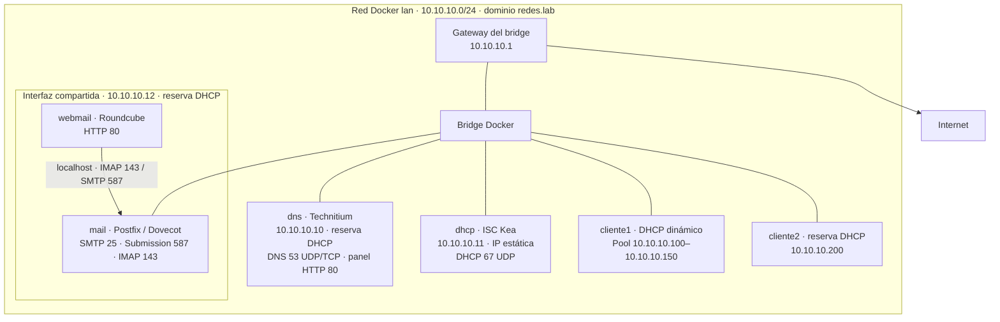

# Actividad Integradora VI – Laboratorio de servicios de red en Docker

## Topología



DNS, mail y los clientes reciben de Kea el gateway, el DNS y el dominio.
Roundcube comparte la interfaz de red de mail mediante `network_mode: service:mail`.

## Software utilizado

| Servicio | Servidor | Cliente | Puerto(s) | ¿Puerto por defecto? |
|---|---|---|---|---|
| DHCP | ISC Kea DHCPv4 2.6.3 (`dhcp/kea-dhcp4.conf`) | `udhcpc` (BusyBox) | 67/UDP servidor, 68/UDP cliente | Sí |
| DNS | Technitium DNS Server 15.6.2 | `dig`, `ping`, resolver del sistema | 53/UDP y TCP | Sí |
| Panel web del DNS | Technitium (web console) | Navegador web | 80/TCP | **No**: por defecto es 5380; se cambió a 80 para entrar por `http://dns.redes.lab` |
| Correo – envío | Postfix (docker-mailserver 16.0.1) | `mutt`, Thunderbird | 587/TCP (Submission), 25/TCP entre servidores | Sí |
| Correo – lectura | Dovecot (docker-mailserver 16.0.1) | `mutt`, `curl`, Thunderbird | 143/TCP (IMAP) | Sí |
| Webmail | Roundcube 1.7.5 (Apache + PHP) | Navegador web | 80/TCP (HTTP); 8080 en la Mac para la LAN | Sí (80) dentro de la red |

## Puesta en marcha

```sh
# Opcional: copiá .env.example a .env y ajustá puertos o credencial DNS.
cp .env.example .env

docker compose up -d --build      # levanta servidores y clientes
sh scripts/setup.sh              # crea la zona DNS y las cuentas de correo
```

Requiere Docker Engine con Compose v2.23.2 o posterior, o Docker Desktop en modo
Linux containers. Para ejecutar el setup en Windows usá Git Bash o WSL con `curl`.
El setup espera hasta 60 segundos al DNS. Los servicios esperan la concesión DHCP
antes de arrancar; los registros del laboratorio se crean al ejecutar el setup.

`.env` permite cambiar los puertos publicados y la contraseña inicial del administrador
DNS sin editar Compose. El setup lee `DNS_PANEL_PORT` y `DNS_ADMIN_PASSWORD` como
valores literales, sin comillas ni interpolación. Una variable exportada tiene prioridad.
Las direcciones y el dominio siguen definidos en Compose, Kea y el setup; si cambiás
la topología, actualizá los tres. Las credenciales son para uso de laboratorio.
Technitium sólo aplica la contraseña inicial al crear su volumen; cambiar `.env`
no modifica la contraseña de un volumen existente.

| Sitio | Con el DNS del laboratorio | Sin cambiar el DNS |
|---|---|---|
| Panel de Technitium (`admin` / `admin`) | <http://dns.redes.lab> | <http://localhost:5380> o <http://10.10.10.10> |
| Webmail Roundcube | <http://mail.redes.lab> | <http://localhost> o <http://10.10.10.12> |

Para usar los nombres, ver [Usar el DNS del laboratorio desde tu computadora](#usar-el-dns-del-laboratorio-desde-tu-computadora).

Cuentas de correo (la contraseña es igual al usuario): `alumno1@redes.lab`, `alumno2@redes.lab`, `profe@redes.lab`.

## Demostraciones (para el video)

### DHCP

```sh
docker logs cliente1                     # DISCOVER → OFFER → REQUEST → ACK
docker logs dns 2>&1 | grep '\[dhcp\]'
docker logs mail 2>&1 | grep '\[dhcp\]'
docker exec dns cat /etc/resolv.conf
docker exec mail cat /etc/resolv.conf
docker logs dhcp | grep -E "DHCP4_LEASE" # el servidor registrando las concesiones
docker exec dhcp cat /var/lib/kea/dhcp4.leases

# Renovar la IP en vivo (captura los paquetes DORA con tcpdump en otra terminal):
docker exec -it cliente1 tcpdump -ni eth0 port 67 or port 68
docker exec cliente1 sh -c 'kill -USR1 $(cat /run/lab-udhcpc)'
```

- Pool dinámico: `10.10.10.100 – 10.10.10.150`, concesión de 1 hora.
- Concesiones persistentes: Kea las guarda en `dhcp/leases/dhcp4.leases` (CSV, se puede abrir en el editor).
  Tras un `docker compose down` / `up`, el servidor recuerda a quién le dio cada IP, como exige [RFC 2131](https://www.rfc-editor.org/rfc/rfc2131#section-3.1).
  `cliente1` tiene MAC fija (`02:42:0a:0a:00:64`) para que el servidor lo reconozca al recrearse, y por eso recibe la misma IP.
- DNS y mail también ejecutan `udhcpc` y reciben gateway, DNS y dominio de Kea.
  Sus MACs `02:42:0a:0a:00:0a` y `02:42:0a:0a:00:0c` tienen reservas
  `10.10.10.10` y `10.10.10.12`. Esas mismas IP figuran en Compose para conservar
  el destino de los puertos publicados por Docker. No cambies una sin la otra.
  DHCP permanece en `10.10.10.11` con configuración estática para evitar depender de sí mismo.
- Roundcube comparte la IP de mail, pero tiene su propio `/etc/resolv.conf`.
  Usa `localhost` para IMAP y SMTP y no ejecuta un segundo cliente DHCP.
- Reserva por MAC: `cliente2` (`02:42:0a:0a:00:c8`) siempre recibe `10.10.10.200`.
- Opciones entregadas: gateway `10.10.10.1`, DNS `10.10.10.10`, dominio `redes.lab`.

### DNS

```sh
docker exec -it cliente1 sh
  cat /etc/resolv.conf        # el DNS lo recibió por DHCP
  dig mail.redes.lab          # registro A
  dig MX redes.lab            # registro MX
  dig -x 10.10.10.12          # resolución inversa (PTR)
  dig smtp.redes.lab          # CNAME
  ping dhcp                   # nombre corto gracias a "search redes.lab"
  dig google.com              # recursión hacia Internet (forwarders 1.1.1.1 / 8.8.8.8)
```

### Correo

1. Abrí <http://mail.redes.lab> (o <http://localhost>) e ingresá con `alumno1` / `alumno1` (no hace falta escribir `@redes.lab`).
2. Redactar → destinatario `alumno2@redes.lab` → Enviar.
3. Cerrá sesión, entrá como `alumno2` y el mensaje aparece en *Entrada*.
4. En paralelo, `docker logs -f mail` muestra a Postfix autenticando a `alumno1` y entregando el mensaje a Dovecot.

### SMTP "a mano" con telnet (muestra el protocolo):

```sh
docker exec -it cliente1 telnet mail.redes.lab 25
  EHLO cliente1
  MAIL FROM:<alumno1@redes.lab>
  RCPT TO:<alumno2@redes.lab>
  DATA
  Subject: hola por telnet

  cuerpo del mensaje
  .
  QUIT
```

## Usar el DNS del laboratorio desde tu computadora

Si el host puede acceder a `10.10.10.0/24`, después del setup puede abrir
`http://mail.redes.lab` y `http://dns.redes.lab`. Para eso configurá
`10.10.10.10` como servidor DNS en los ajustes de red del sistema operativo.
Con Docker Desktop usá los puertos publicados en `localhost`; las IP internas
no son accesibles directamente desde el host.

**Requisito: la computadora tiene que poder llegar a la red `10.10.10.0/24`.**

| Entorno | ¿Llega a `10.10.10.x`? |
|---|---|
| Linux con Docker Engine | Sí, el bridge de Docker es una interfaz del propio equipo. |
| macOS con OrbStack | Sí, OrbStack enruta las IPs de los contenedores hacia la Mac. |
| macOS / Windows con Docker Desktop | **No**: usá `localhost:5380` para el panel y `localhost` o `localhost:8080` para webmail. Las pruebas de DNS se ejecutan dentro de los clientes. |

> **Importante:** mientras el DNS de la computadora sea `10.10.10.10`, toda la resolución de nombres depende de que el contenedor `dns` esté levantado.
> Al terminar, o si se apaga Docker, volvé el DNS a "Automático" o vas a quedarte sin Internet "por nombre".

## Archivos

- `compose.yaml`: topología, IPs y variables de cada servicio.
- `.env.example`: puertos publicados y contraseña inicial DNS; copiar a `.env`.
- `.gitattributes` y `.editorconfig`: finales de línea LF para todos los archivos de texto.
- `network/`: arranque DHCP y hook compartidos por clientes, DNS y mail.
- `dns/Dockerfile` y `mail/Dockerfile`: agregan DHCP a las imágenes originales y conservan sus comandos de arranque.
- `dhcp/kea-dhcp4.conf`: pool, reserva y opciones DHCP.
- `dhcp/leases/`: base de concesiones de Kea (la escribe el servidor; no editar a mano con el servicio corriendo).
- `cliente/`: imagen de los equipos cliente (`udhcpc`, `dig`, `mutt`, `tcpdump`, `telnet`).
- `mail/config/`: cuentas y ajustes de Postfix/Dovecot. Habilita autenticación **sin TLS**, sólo para el laboratorio.
- `webmail/config.inc.php`: ajustes de Roundcube (idioma, dominio por defecto, autenticación SMTP).
- `scripts/setup.sh`: crea la zona `redes.lab` en Technitium por API y las cuentas de correo.

## Agregar más clientes

Copiá el bloque `cliente1` en `compose.yaml` con otro nombre (`cliente3`, …) y otra MAC única y ejecutá `docker compose up -d cliente3`.

## Reiniciar todo de cero

```sh
docker compose down -v && rm -f mail/config/postfix-accounts.cf mail/config/postfix-virtual.cf
```

## Verificación después del setup

```sh
docker compose ps
docker compose exec cliente1 dig mail.redes.lab
docker compose exec cliente2 dig MX redes.lab
docker compose exec dns cat /etc/resolv.conf
docker compose exec mail cat /etc/resolv.conf
docker compose exec dhcp cat /var/lib/kea/dhcp4.leases
```

DNS y mail deben mostrar `nameserver 10.10.10.10` y `search redes.lab`.
En las concesiones deben aparecer las reservas `.10`, `.12` y `.200`, además de
la IP dinámica de cliente1. Para probar la renovación sin reiniciar el servicio:

```sh
docker compose exec mail sh -c 'kill -USR1 $(cat /run/lab-udhcpc)'
docker compose logs --tail=20 dhcp
```

El hook reemplaza la dirección al renovar sin vaciar la interfaz, para conservar
las conexiones activas. Si Kea no responde al arrancar, el servicio falla después
de los intentos de `udhcpc`; revisá `docker compose logs dhcp dns mail cliente1 cliente2`.
